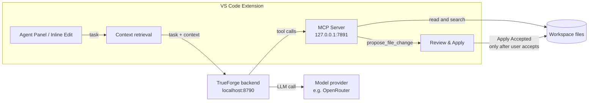

<picture>
  <source media="(prefers-color-scheme: light)" srcset="docs/brand/voltix-lockup-on-light.svg">
  
</picture>

**A transparent, surgical AI coding agent for VS Code — it proposes, you approve.**

Voltix defers read-tool schemas (file listing, search, and reading) in TrueForge context so the initial agent prompt stays smaller; edit, verify, run, and submit tools remain preloaded so writes and review never stall.

## TrueForge features used

- **Named sessions:** Each task receives a readable title and remains linkable from the TrueForge Sessions view.
- **Streaming events:** Voltix consumes SSE turn, model, tool, approval, cancellation, and compaction events in real time.
- **Cancellation:** Stop cancels the active TrueForge turn and verifies the workspace remains unchanged.
- **MCP tools:** Voltix exposes guarded workspace read, edit, verification, command, and submit tools through a loopback MCP server.
- **Approval-driven review:** `submit_changes` pauses the TrueForge turn until accepted hunks are applied or changes are rejected.
- **Deferred tool loading:** Read-only discovery tools stay deferred while write, verification, command, and submit tools remain preloaded.
- **Context compaction:** Long sessions compact automatically after 70,000 estimated input tokens and report it in the Voltix activity log.

[](https://code.visualstudio.com/)
[](https://www.typescriptlang.org/)
[](https://modelcontextprotocol.io/)
[](https://www.truefoundry.com/)
[](https://techfest.org/)

Many AI coding agents can make changes without a review step. Voltix assembles relevant workspace context, stages localized changes through MCP, and writes proposed code changes only after you accept them. Review changes by hunk or file before applying them.

<!-- Record and add the Voltix demo GIF at docs/demo.gif. -->


**Built for:** Techfest 2026–27 TrueFoundry Forge-a-thon.

## Features

| Feature | What it does |
|---|---|
| Agent Mode | Sends your task and selected workspace context to TrueForge, then presents proposed changes for review. |
| Inline Edit | Uses the selected code and your instruction to request a proposal for the current file, then opens a side-by-side diff. |
| Context Receipt | Shows selected files and excerpts, query terms, and token-budget information. Current retrieval labels items with `explicit_mention` or `keyword_match`. The shared type also reserves `filename_match`, `symbol_match`, `import_relationship`, and `recency`; those are not currently emitted by the retriever. |
| MCP workspace tools | Gives TrueForge workspace listing, reading, searching, change-proposal, and allowlisted command tools through a loopback MCP server. |
| Hunk-level review | Accept or reject individual hunks, or accept or reject a whole proposed file. |
| Apply Accepted | Applies accepted hunks or accepted files after you explicitly choose to apply them. |
| Conflict detection | Refuses to write a proposed change if the current file content no longer matches the content hash recorded when the proposal was created. |
| Command safety | Restricts commands to an allowlist and shows a modal Run/Cancel confirmation before execution. |
| Path guard | Workspace file operations reject paths outside the open workspace and detect symlink escapes. The command tool also restricts its working directory to the workspace. |

## Architecture



The extension is both a TrueForge client and an MCP server named `vscode-workspace`. Agent Mode sends the task and selected context to the TrueForge backend, which calls the configured model provider. When the backend needs workspace access, it calls the extension’s MCP server at `127.0.0.1:7891`. File-change proposals become pending review items; applying them to workspace files is a separate, explicit action.

## MCP tools

| Tool | Purpose | Safety |
|---|---|---|
| `list_workspace_files` | Lists workspace files, optionally matching a glob pattern. | Excludes `node_modules` and `.git`; returns at most 500 paths. |
| `read_file` | Reads a workspace file. | Applies workspace path and symlink checks. |
| `search_workspace` | Searches supported text files for a query. | Excludes `node_modules` and `.git`; returns at most 200 matching paths. |
| `propose_file_change` | Registers a proposed file change for review. | Does not write the file; the proposal waits for review and acceptance. |
| `run_command` | Runs a command from the workspace. | Checks the command allowlist and working directory, asks for modal Run/Cancel confirmation, uses a 30-second timeout, caps each output stream at 10,000 characters, and scrubs output matching the secret pattern. |

The command allowlist patterns are:

```text
^python\s
^python3\s
^pip\s+install\b
^flask\b
^pytest\b
^npm\s+(test|run)\b
^npx\b
^git\s+(status|diff|log)\b
```

Command output scrubbing redacts values matched after `password`, `secret`, `token`, or `key` followed by `:` or `=`.

## Quick start

### Prerequisites

- macOS or Linux
- Node.js and npm
- VS Code `^1.95.0`
- An API key for a model provider. OpenRouter, for example, offers models with free-tier availability.

### 1. Clone and build the extension

```zsh
git clone https://github.com/aadyasingh1/Trueforge.git
cd Trueforge/extension && npm install && npm run compile
```

### 2. Start the TrueForge backend

In a separate terminal, start TrueForge with loopback access enabled:

```zsh
OUTBOUND_URL_ALLOWED_HOSTS='["127.0.0.1"]' npx @truefoundry/trueforge
```

TrueForge blocks outbound connections to loopback/private addresses by default. This setting allows the backend to reach the extension’s MCP server at `127.0.0.1` without allowing other hosts through this setting. Wait for:

```text
Agent server listening on http://localhost:8790
```

### 3. Launch the extension

Open the repository root in VS Code and press **F5** using the **Run Voltix Extension** configuration in `.vscode/launch.json`. In the Extension Development Host, open the project folder you want Voltix to work in; the extension requires an open workspace folder.

### 4. Open the Voltix panel

Open the panel with **Cmd+Shift+A** on macOS or **Ctrl+Shift+A** on Windows/Linux. This command activates the extension if needed; the extension also declares `onStartupFinished` activation. The MCP server starts during extension activation.

### 5. Configure a model provider

In TrueForge, open [http://localhost:8790/settings](http://localhost:8790/settings) and go to **Models → Add Custom Provider**.

Example using OpenRouter:

| Field | Example |
|---|---|
| Name | `openrouter` |
| Base URL | `https://openrouter.ai/api/v1` |
| API key | Your provider API key |
| Model ID | `cohere/north-mini-code:free` |
| Model name | `north-mini-code` |

The full model name used by the extension is `openrouter/north-mini-code`.

### 6. Connect the extension’s MCP server

In TrueForge, go to **Settings → Connectors → Add MCP Server**:

| Field | Value |
|---|---|
| Name | `vscode-workspace` |
| URL | `http://127.0.0.1:7891/mcp` |
| Auth type | `None` |

The connector should show **Connected** with five tools.

### 7. Select the model in VS Code

Set `voltix.model` to `openrouter/north-mini-code` in VS Code Settings.

## Usage

### Agent Mode

1. Open the Voltix panel and describe a task.
2. Review the context receipt and proposed diff card.
3. Accept or reject hunks, or accept or reject the whole file.
4. Choose **Apply Accepted** to write accepted changes.

### Inline Edit

1. Select code and run **Voltix: Inline Edit** from the Command Palette.
2. Enter an instruction and review the side-by-side diff.
3. Choose **Accept & Apply** or **Reject**.

The configured **Cmd+Shift+I** shortcut may be used by Copilot Chat in newer VS Code versions; the Command Palette is the reliable way to run Inline Edit.

### Example

Given a `math.js` function with an off-by-one loop:

```js
function average(numbers) {
  let total = 0;
  for (let i = 0; i <= numbers.length; i++) total += numbers[i];
  return total / numbers.length;
}
```

Voltix can propose the localized fix:

```diff
-  for (let i = 0; i <= numbers.length; i++) total += numbers[i];
+  for (let i = 0; i < numbers.length; i++) total += numbers[i];
```

## Configuration

| Setting | Default | Description |
|---|---|---|
| `voltix.baseUrl` | `http://localhost:8790` | URL of the TrueForge backend. |
| `voltix.model` | `anthropic/claude-sonnet-4-6` | Configured provider and model name. |
| `voltix.contextTokenBudget` | `8000` | Maximum token estimate for selected workspace context; minimum `500`. |

## Safety model

- **Proposals before code writes:** MCP `propose_file_change` registers pending review data; it does not write the file.
- **Explicit acceptance:** accepted hunks or a whole file must still be submitted through **Apply Accepted** to write changes. Inline Edit separately asks you to accept and apply.
- **Conflict checks:** before applying, Voltix compares the current file’s SHA-256 content hash with the hash recorded for the proposal.
- **Workspace path checks:** workspace file tools enforce workspace containment and check symlink destinations.
- **Command controls:** commands must match the allowlist and receive an explicit modal Run confirmation. The command tool sets a 30-second timeout.
- **Loopback binding:** the extension MCP HTTP server listens on `127.0.0.1`, not on all network interfaces.

## Project structure

```text
extension/src/
├── agent/       TrueForge client sessions and stream processing
├── commands/    Agent Mode and inline-edit commands
├── config/      VS Code settings
├── context/     Workspace scanning, retrieval, ranking, and mentions
├── review/      Pending changes, diff hunks, conflict checks, and apply logic
├── tools/       MCP server, path guard, and command handler
├── ui/          Agent webview panel
└── utils/       Logging and error helpers
shared/
└── types.ts     Shared context, hunk, change, and message types
extension/tests/unit/
               Jest unit tests
```

## Development

Run commands from the extension directory:

```zsh
cd extension
npm run compile
npm run watch
npm test
```

`npm run compile` type-checks and bundles the extension. `npm run watch` watches TypeScript compilation. `npm test` runs the Jest unit tests in `extension/tests/unit`.

## Troubleshooting

| Symptom | Fix |
|---|---|
| `Outbound URL blocked for host 127.0.0.1` | Start TrueForge with `OUTBOUND_URL_ALLOWED_HOSTS='["127.0.0.1"]'`. |
| `fetch failed` | The TrueForge backend is not running on port `8790`; start or restart it. |
| Port `7891` is not listening | Open the Voltix panel once to activate the extension, then check the MCP server output in VS Code. |
| Check whether the backend and MCP server are listening | Run `lsof -nP -iTCP:8790 -iTCP:7891 -sTCP:LISTEN`. |
| Agent replies in text but no diff appears | Check that the `vscode-workspace` connector is **Connected** and that the selected model supports tool calling. |
| `Voltix requires an open workspace` | Open a folder in the Extension Development Host. |

## Roadmap

- Show MCP tool calls live in the panel.
- Add in-panel approval for `run_command`.
- Create and document multi-file demo tasks.
- Package the extension as a `.vsix`.

## Acknowledgements

Built with TrueFoundry TrueForge and the Model Context Protocol for the Techfest 2026–27 Forge-a-thon.

<!-- add team members -->
