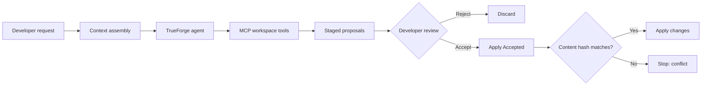
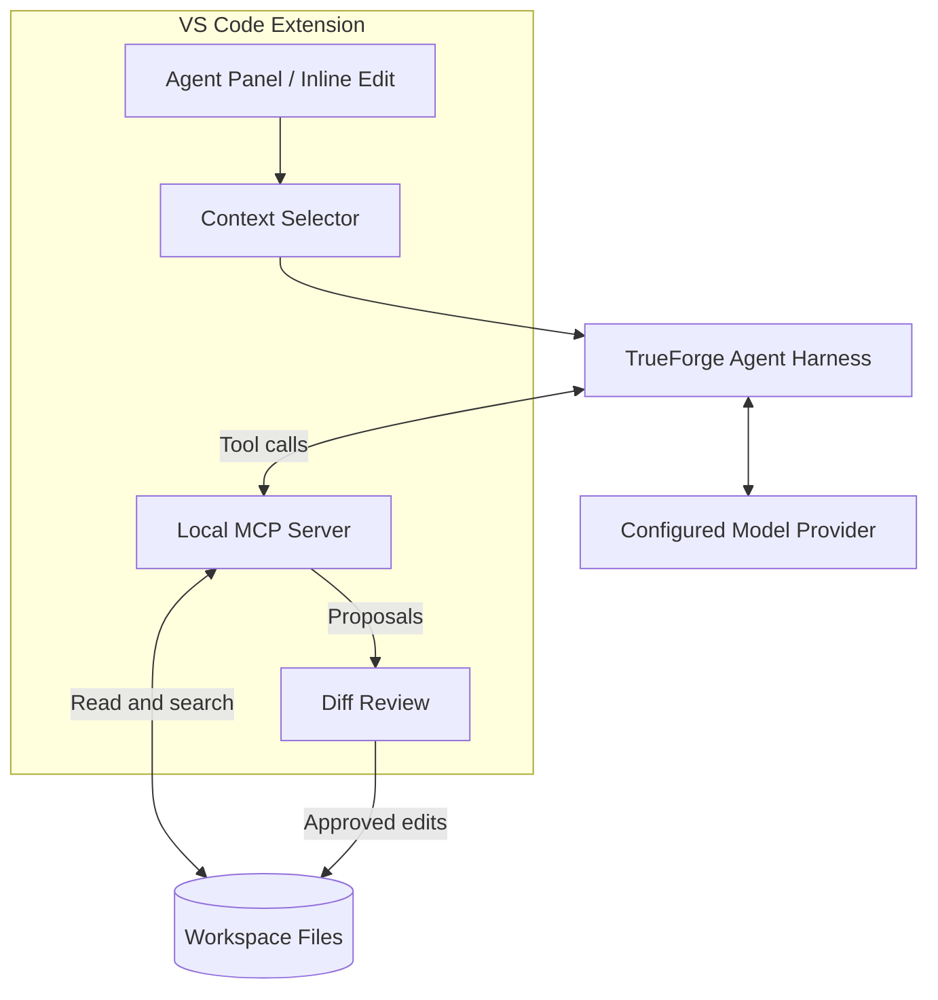

<div align="center">

# Voltix

### A coding agent that shows its work before changing yours.

**Repository-aware context · TrueForge orchestration · Review-first edits**

[](https://code.visualstudio.com/)
[](https://github.com/truefoundry/trueforge)
[](https://modelcontextprotocol.io/)
[](LICENSE)

[**Explore the demo**](#see-voltix-in-action) · [**Get started**](#quick-start) · [**Architecture**](#architecture) · [**Safety**](#safety-by-design)

</div>

---

## See Voltix in action


https://github.com/user-attachments/assets/b21b3f78-f058-4004-893f-930c5f028bee


## Why Voltix?

An agent can produce a plausible patch while still reading the wrong code, touching unrelated files, or overwriting changes made after its proposal.

Voltix treats these as engineering problems—not just prompt-writing problems.

**The central idea is to separate what the agent recommends from what the editor commits.**

TrueForge runs the agent loop; VS Code provides scoped workspace tools and a human review boundary. Developers can inspect retrieved context, review proposed changes and decide what gets applied.

| Understand the context | Inspect the change | Control execution |
| :--- | :--- | :--- |
| See selected files, excerpts, retrieval reasons and token estimates. | Review individual hunks or entire files before applying. | Use conflict checks, command confirmation and workspace safeguards. |

---

## What makes Voltix different

### 01 — Context receipts, not invisible retrieval

Voltix makes context selection visible.

Explicit `@file` and `@symbol` references work alongside automatic keyword-based retrieval. A configurable context budget defaults to **8,000 estimated tokens**.

The context receipt shows which files were selected and why.

Current retrieval labels include `explicit_mention` and `keyword_match`. Advanced symbol-aware and import-relationship ranking are not claimed as implemented.

### 02 — Propose first, write later

Voltix separates generating a change from applying it.

In Agent Mode, proposed changes are staged for review. Developers can accept or reject individual hunks or entire files, then explicitly select **Apply Accepted**.

The agent does not silently commit those proposed edits to the original workspace files.

### 03 — Conflict-aware editing

A proposal may become outdated while the developer is reviewing it.

Voltix records a SHA-256 content hash when creating the proposal and compares it with the file's current hash before application.

If the file has changed, the stale proposal is rejected rather than overwriting newer content.

### 04 — Scoped agent execution

Voltix's workspace tools operate within defined boundaries:

- Workspace path containment
- Symbolic-link escape detection
- Command allowlisting
- Explicit terminal-command confirmation
- Execution timeouts
- Bounded command output
- Best-effort sensitive-output redaction

These safeguards limit what an agent can access or execute through the exposed tools.

### 05 — A committed TrueForge agent definition

Voltix includes an actual [`agent-definition.json`](agent-definition.json).

Its instructions describe a search-first workflow, localized editing, staged change proposals and verification of pending edits.

This keeps the agent's intended behavior inspectable alongside the extension source.

---

## How Voltix works



### Two ways to work

| Mode | Workflow |
| --- | --- |
| **Inline Edit** | Select code, enter an instruction, inspect the editor diff, then accept/apply or reject. |
| **Agent Mode** | Describe a repository-level task, let TrueForge discover relevant code, inspect proposed changes, then apply accepted edits. |

---

## Architecture



### Separation of responsibilities

**TrueForge** owns agent sessions, model interaction and tool orchestration.

**Voltix** provides the editor interface, workspace context, MCP tools and review experience.

**The developer** controls whether proposed changes reach the workspace.

The local MCP endpoint is configured at:

`http://127.0.0.1:7891/mcp`

The TrueForge backend is expected at:

`http://localhost:8790`

### Workspace tools

| Tool | Responsibility |
| --- | --- |
| `list_workspace_files` | Discover files within the workspace. |
| `search_workspace` | Search repository content for relevant matches. |
| `read_file` | Read workspace files with path checks. |
| `propose_file_change` | Stage file changes for review. |
| `run_command` | Execute permitted commands with confirmation and limits. |
| `edit_file` | Targeted editing workflow referenced by the agent definition. |
| `verify_changes` | Pending-change verification workflow referenced by the agent definition. |

The original extension documentation describes five core MCP tools. The committed agent definition additionally references `edit_file` and `verify_changes`; their availability should be confirmed in the running build.

---

## Quick start

### Prerequisites

- Visual Studio Code 1.95 or later
- Node.js and npm
- TrueForge running locally
- A model provider configured in TrueForge
- Provider credentials where required

### 1. Clone Voltix

```bash
git clone https://github.com/aadyasingh1/Voltix.git
cd Voltix/extension
npm install
npm run compile
```

### 2. Start TrueForge

On macOS or Linux:

```bash
OUTBOUND_URL_ALLOWED_HOSTS='["127.0.0.1"]' npx @truefoundry/trueforge@latest
```

This allows TrueForge to connect to the extension's loopback MCP endpoint.

The expected backend address is:

`http://localhost:8790`

### 3. Launch the extension

Open the Voltix repository in VS Code.

Press **F5** and select the **Run Voltix Extension** launch configuration.

In the Extension Development Host, open the workspace you want Voltix to work with.

Open the Voltix panel using:

- macOS: `Cmd+Shift+A`
- Windows/Linux: `Ctrl+Shift+A`

You can also use the VS Code Command Palette.

### 4. Configure a model

Open:

`http://localhost:8790/settings`

Configure your model provider under **Models**.

The committed agent definition references `openrouter/north-mini-code`. Select a model that is available in your TrueForge configuration.

Set `voltix.model` in VS Code to the corresponding configured model.

### 5. Connect MCP

In TrueForge, navigate to:

**Settings → Connectors → Add MCP Server**

| Setting | Value |
| --- | --- |
| Name | `vscode-workspace` |
| URL | `http://127.0.0.1:7891/mcp` |
| Authentication | None |

The connector should connect to the local extension server.

### 6. Start coding

For **Inline Edit**, select a function and run **Voltix: Inline Edit** from the Command Palette.

For **Agent Mode**, describe a task involving multiple parts of the repository without specifying every file.

Review the context and proposed changes before applying them.

---

## Safety by design

| Protection | Implementation |
| --- | --- |
| Review boundary | Proposed edits remain pending until approved. |
| Conflict detection | SHA-256 content comparison before applying. |
| Workspace isolation | Path containment and symlink checks. |
| Command restrictions | Pattern-based allowlist. |
| Execution approval | Explicit Run/Cancel confirmation. |
| Timeout | Documented 30-second command limit. |
| Output limits | Documented 10,000-character cap per output stream. |
| Output redaction | Best-effort matching of common secret-related fields. |
| Local connectivity | MCP server bound to loopback. |

These protections reduce risk but do not guarantee that arbitrary model-generated code is safe. Developers should inspect and test changes before relying on them.

---

## Forge-a-thon evaluation

Voltix was developed for the **Techfest IIT Bombay × TrueFoundry Forge-a-thon 2026–27**.

The official evaluation focuses on observable behavior across three fixed tasks.

### Task A — Inline editing

Update Flask's `get_debug_flag` function so that `off` and `n` are also treated as false, case-insensitively.

The demonstration should show the generated diff, developer review and the verified result.

### Task B — Multi-file agent workflow

Ask the agent to introduce a `flask config` CLI command that prints application configuration as JSON while masking sensitive keys.

The agent must discover the relevant files itself and produce changes spanning implementation, tests and documentation.

The demonstration should include the TrueForge session and the resulting verification.

### Task C — Resilience

Configure an invalid or unreachable model endpoint and repeat the inline-edit task.

The demonstration should show that the editor remains responsive, communicates the failure or fallback clearly, and leaves the workspace unchanged.

### Evaluation criteria

| Category | Maximum points |
| --- | ---: |
| Capability coverage | 30 |
| Technical depth | 45 |
| Presentation | 25 |
| **Total** | **100** |

This section describes the competition's evaluation requirements, not a claim that every maximum-scoring behavior has been demonstrated.

Automatic model fallback, cancellation consistency, post-apply undo and advanced TrueForge context-engineering features should be verified against the current build before being advertised as completed.

---

## Project structure

```text
Voltix/
├── .vscode/
├── config/
├── docs/
│   └── voltix-demo.gif
├── extension/
│   ├── src/
│   │   ├── agent/
│   │   ├── commands/
│   │   ├── context/
│   │   ├── review/
│   │   ├── tools/
│   │   └── ui/
│   └── tests/unit/
├── shared/
├── agent-definition.json
├── .env.example
├── LICENSE
└── README.md
```

---

## Development

From the `extension` directory:

```bash
npm run compile
npm run watch
npm test
```

### Troubleshooting

| Problem | What to check |
| --- | --- |
| TrueForge cannot reach the MCP endpoint | Start TrueForge with the loopback allowance. |
| `fetch failed` | Check whether TrueForge is running on port `8790`. |
| No MCP tools available | Activate the extension and check the connector at port `7891`. |
| Model responds but no proposed edits appear | Check MCP connectivity and model tool-calling support. |
| No open workspace | Open a project folder in the Extension Development Host. |

---

## Built with

- [TrueFoundry TrueForge](https://github.com/truefoundry/trueforge)
- [Visual Studio Code Extension API](https://code.visualstudio.com/api)
- [Model Context Protocol](https://modelcontextprotocol.io/)
- TypeScript and Node.js

## License

Voltix is distributed under the [MIT License](LICENSE).

Any reused upstream code must retain the applicable license and attribution. The exact upstream fork point, if any, should be documented.

## Acknowledgements

Built for the **TrueFoundry Forge-a-thon at Techfest IIT Bombay 2026–27**.

Powered by TrueForge and the Model Context Protocol.

---

<div align="center">

**Voltix — Code with control.**

</div>
